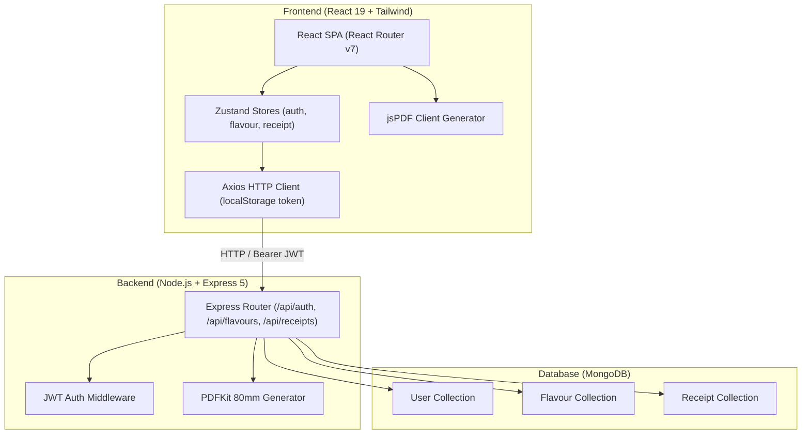

# Initial Engineering Audit: Juice Receipt App

**Date:** November 15, 2026  
**Auditor:** Principal Software Engineer & Antigravity Autonomous Agent  
**Repository:** https://github.com/SadeeshaJayaweera/Receipt_App  
**Branch:** `feature/pr-01-baseline-audit`  

---

## 1. Executive Summary

The **Juice Receipt App** is a full-stack web application designed for small juice and beverage businesses to manage beverage flavors, generate point-of-sale customer receipts, support thermal printing (80mm), export PDFs, and track sales history.

While the existing prototype demonstrates functional core ideas, a comprehensive engineering inspection reveals severe architectural, security, financial, and operational deficiencies that prevent it from being safe or reliable for production business usage.

This audit establishes the baseline facts before executing a 40-Pull-Request transformation into an enterprise-grade SaaS platform powered by Material UI (MUI), resilient financial calculation engines, strict data isolation, and robust automated quality gates.

---

## 2. Existing System Architecture



### Component Analysis
- **Frontend:** React 19.2.3, React Router v7.13.0, Zustand 5.0.10, Tailwind CSS 3.x, Axios 1.13.2, jsPDF 4.0.0, date-fns 4.1.0, Recharts 3.7.0.
- **Backend:** Node.js 20.x, Express 5.2.1, Mongoose 9.1.5, JWT 9.0.3, bcryptjs 3.0.3, PDFKit 0.17.2, Helmet 8.1.0, Compression 1.8.1.
- **Database:** MongoDB (Local / Atlas).

---

## 3. Existing Feature Inventory & Behavior

| Feature Area | Current Status | Description & Limitations |
| :--- | :--- | :--- |
| **Authentication** | Partially Functional | Register, Login, Profile GET/PUT. Uses 30-day JWT. Passwords hashed with bcrypt (10 rounds). Plaintext passwords logged to stdout. |
| **Flavour / Product Management** | Partially Functional | CRUD operations on flavours. Soft delete (`isActive: false`). No category, SKU, stock, or archiving audit trail. |
| **Receipt Creation** | Defective Financial Logic | Line item entry, client-side subtotal, payment method selection. Backend trusts client `totalAmount` without verification. |
| **Receipt History** | Inefficient Prototype | Fetches *all* historical receipts into frontend memory without pagination, search, or server-side filtering. |
| **Thermal Printing (80mm)** | Fragile | Injects raw HTML into an unmanaged popup via `window.open()`. Vulnerable to popup blockers and browser print clipping. |
| **PDF Generation** | Inconsistent Dual Implementation | Client-side jsPDF with hardcoded positions; server-side PDFKit with fixed `[226, 600]` height that clips long receipts. |
| **Multi-Currency** | Broken / Visual Only | Hardcoded exchange rate (`320`). Converts currency visually in UI, but stores unconverted LKR in database with no currency field. |
| **Dashboard Analytics** | Client-side Aggregation | Calculates today's sales by filtering entire receipt list in frontend JavaScript. Non-scalable. |

---

## 4. Critical Engineering Audit Findings

### 4.1 Security Risks (Severity: CRITICAL)
1. **Plaintext Credential Logging:** In `backend/routes/auth.js`, `console.log('Register request received:', { body: req.body });` outputs cleartext user passwords to server logs.
2. **Insecure CORS Fallback:** `backend/server.js` contains `else { callback(null, true); }`, effectively granting universal origin access with `credentials: true`.
3. **No Brute-Force Protection:** No rate limiting on `/api/auth/login` or `/api/auth/register`, enabling automated credential stuffing.
4. **Weak JWT Architecture:** Tokens have a fixed 30-day lifetime stored in browser `localStorage`, with no token blacklist, revocation list, or refresh token flow.
5. **No Input Sanitization / Schema Validation:** Request bodies are destructured directly without schema validation (e.g., Zod), opening risks to NoSQL injection and parameter pollution.

### 4.2 Financial Correctness & Data Integrity (Severity: CRITICAL)
1. **Blind Backend Trust:** `POST /api/receipts` accepts `totalAmount` directly from the client without recalculating `sum(quantity * price)`. Malicious or buggy clients can create receipts with arbitrary totals.
2. **Missing Currency Model:** The `Receipt` schema has no `currency` field. USD transactions are recorded as raw numbers in LKR.
3. **Floating-Point Arithmetic:** Calculations use standard JavaScript `Number` multiplication (`quantity * price`), risking IEEE-754 precision artifacts.
4. **Race-Condition Prone Receipt Numbering:** Receipt numbering relies on `countDocuments({ userId })` inside a `pre('save')` hook concatenated with `Date.now()`. Concurrent transactions generate duplicate or non-sequential identifiers.
5. **Destructive Receipt Deletion:** `DELETE /api/receipts/:id` hard-deletes financial records, violating fundamental accounting audit trail principles.
6. **Uncontrolled Receipt Mutations:** `PUT /api/receipts/:id` allows altering line items and totals on already-issued receipts without an audit trail.

### 4.3 Architecture & Code Quality (Severity: HIGH)
1. **Filesystem Case-Sensitivity Bug:** The receipt route file is named `backend/routes/Receipt.js` (capital R). On case-sensitive Linux deployment targets, `require('./routes/Receipt')` vs `require('./routes/receipt')` causes fatal runtime crashes.
2. **No Backend Separation of Concerns:** Route handlers contain database queries, business rules, PDF generation, and response formatting in single monolithic callbacks.
3. **Missing Automated Testing:** Zero backend test suites exist (`npm test` fails with `Missing script: "test"`). Frontend tests failed out of the box due to missing installed packages and React 19 testing library issues.
4. **In-Memory Filtering:** Frontend loads the entire historical receipt dataset over HTTP to compute dashboard statistics and perform table searches.

### 4.4 UI/UX & Output Deficiencies (Severity: HIGH)
1. **Lack of Design System:** Handcrafted Tailwind utility classes with inconsistent margins, padding, borders, and colors across views.
2. **No Material UI:** The user specifically requires a transition to Material UI (MUI) for professional, accessible, and enterprise-grade UI components.
3. **Hardcoded PDF Details:** Server-side PDF template hardcodes "FRESH JUICE" and "Tel: N/A", ignoring the authenticated user's business profile.
4. **Thermal Printer Formatting:** Popups opened via `window.open` fail when browser popup blockers are active, and paper sizing lacks standard CSS `@page` media rules for 80mm roll printers.

---

## 5. Baseline Build & Test Execution Results

```
Command: cd backend && npm test
Result: FAILED (npm error Missing script: "test")

Command: cd frontend && npm test -- --watchAll=false
Result: FAILED (sh: react-scripts: command not found - node_modules uninstalled)

Command: cd backend && node -e "require('./server')"
Result: FAILED (Cannot connect to MongoDB without active MONGODB_URI; process exits)
```

---

## 6. Transformation Roadmap & Success Metrics

To solve all identified issues systematically, the project will execute **40 distinct, reviewable GitHub Pull Requests** categorized into 8 core phases:

- **Phase A (PR-01 – PR-05):** Audit, testing foundations, config validation, clean backend architecture, and request validation.
- **Phase B (PR-06 – PR-10):** Auth hardening, business data isolation, rate limiting/security headers, schema indexes, and atomic receipt numbering.
- **Phase C (PR-11 – PR-15):** Authoritative financial calculation engine, business rules validation, product lifecycle/archiving, customer management, and receipt lifecycle (Draft/Issued/Void).
- **Phase D (PR-16 – PR-18):** Server-side pagination & search, server-aggregated analytics dashboard, and multi-currency (LKR/USD) engine.
- **Phase E (PR-19 – PR-21):** Resilient PDF generation, 80mm thermal print engine, and business branding settings.
- **Phase F (PR-22 – PR-30):** Full Material UI (MUI) design system migration (themes, app shell, dashboard, products, POS receipt creation, history, settings, accessibility).
- **Phase G (PR-31 – PR-33):** State management, network resilience with idempotency, structured audit logging, and health observability.
- **Phase H (PR-34 – PR-40):** Comprehensive backend integration tests, frontend component tests, E2E flows, CI/CD pipelines, Docker containerization, disaster recovery, and production readiness certification.

---
*Audit completed and certified for PR-01 baseline.*
